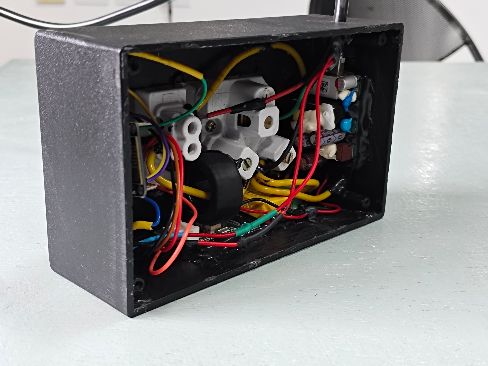

# VoltX

A DIY mains-powered energy monitor / smart plug built into a black project enclosure.

**Author:** [tamileniyangt-cyber](https://github.com/tamileniyangt-cyber)



## Hardware (from the build photo)

- Black ABS project enclosure
- 240V socket outlet (rated 10A/16A, 240V~)
- Toroidal current-sensing coil (the load live wire passes through it)
- Small display module (left side)
- Mains-to-low-voltage power supply board with capacitors (right side)
- Microcontroller / sensor board (bottom)

> Update this list with exact part numbers once confirmed.

## Project structure (planned)

```
voltx/
├── README.md
├── images/        # build photos
├── firmware/      # microcontroller code
├── hardware/      # wiring diagram, BOM
└── docs/          # calibration and usage notes
```

## Getting started

1. Clone the repo:
   ```
   git clone https://github.com/tamileniyangt-cyber/VoltX.git
   ```
2. Add your firmware under `firmware/`.
3. Add wiring diagram under `hardware/`.

## Safety notice

This device connects to **mains voltage, which can kill**. Before powering it on:

- Insulate every mains join with proper heat-shrink or screw terminals, not glue or tape.
- Fit a fuse or breaker rated for the load on the live line.
- Keep mains wiring physically separated from low-voltage electronics.
- Secure the cable entry with a strain relief, and close and screw down the lid.
- Never open or probe the device while it is plugged in.

## License

Choose a license (e.g. MIT) and add a `LICENSE` file.
